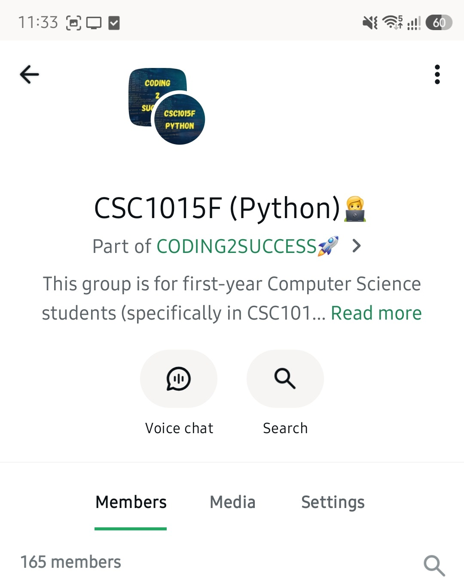
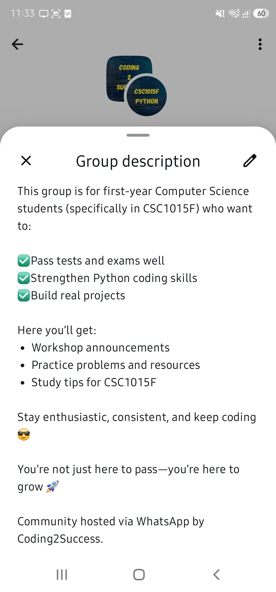
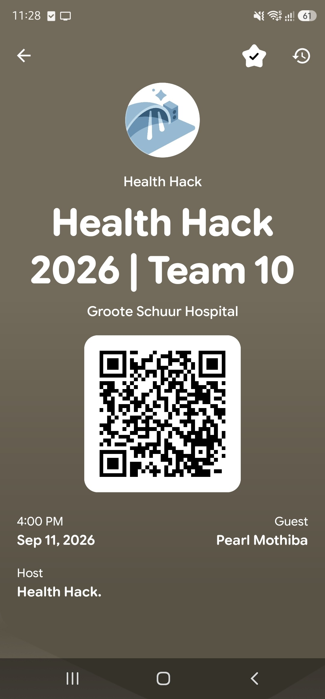
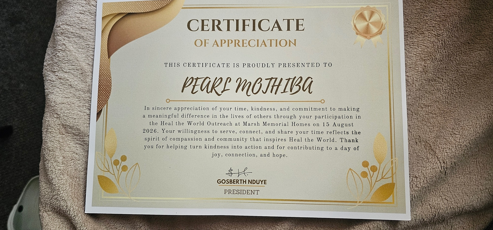
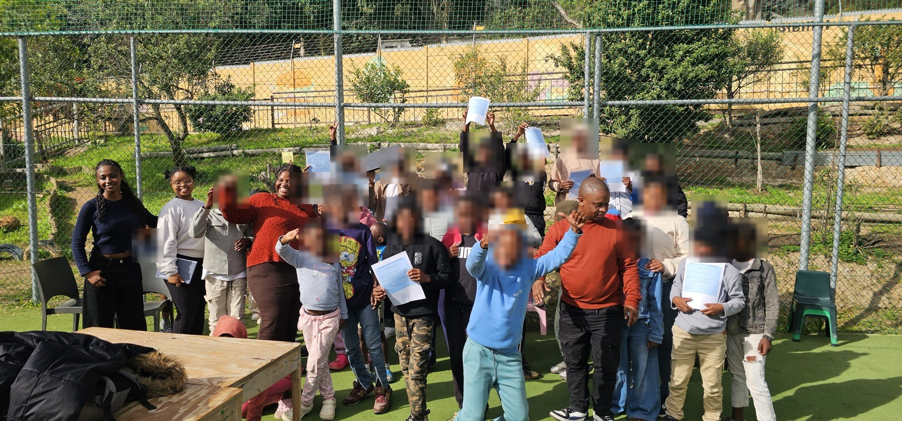

# Sekoati Pearl Mothiba – Proof of Work

Evidence supporting my CV and essay for the Mastercard Foundation Scholars Program at the University of Cape Town.

---

## 1. Coding2Success (co-founder, 2025 – 2026)

A student-led venture that supported first-year Computer Science students (CSC1015F) through workshops, practice problems and study tips.

| Evidence | What it shows |
|---|---|
| [WhatsApp community – 165 members](1_Coding2Success/whatsapp_165_members.jpg) | Size of the student community we built |
| [WhatsApp group description](1_Coding2Success/whatsapp_group_description.jpg) | Purpose of the community and the support we offered |
| [2025 end-of-year workshop feedback](1_Coding2Success/workshop_feedback_2025.pdf) | Anonymous feedback from students, including reported mark improvements |

 

---

## 2. Health-tech idea: Wearable monitor for patients waiting after triage (2026 – present)

Problem: after triage in public emergency units, patients can wait for hours without being checked again, and their condition can get worse without staff noticing.

| Evidence | What it shows |
|---|---|
| [Fellowship Founders Pitch – Ideation evidence](2_Triage_Wearable_Idea/FFP_ideation_evidence_names_hidden.pdf) | Interviews with doctors and a nurse, a student survey, my observation at the Groote Schuur Hospital triage area, research articles, and early system sketches |

*Interviewee names are hidden to protect their privacy.*

> If a PDF preview does not load, click **Download raw file** (the download icon at the top right of the file view).

---

## 3. HealthHack 2026 – Groote Schuur Hospital (11 – 13 September 2026)

The first hackathon hosted by Groote Schuur Hospital. I worked in a team on the triage problem with a medical doctor mentor and pitched my triage monitoring idea.

| Evidence | What it shows |
|---|---|
| [HealthHack 2026 ticket – Team 10](3_HealthHack_2026/healthhack_2026_ticket.jpg) | My registration and team at the event |

---

## 4. Community work

| Evidence | What it shows |
|---|---|
| [Heal the World – Certificate of Appreciation](4_Community_Work/heal_the_world_certificate_marsh_memorial_homes.jpg) | My participation in the Heal the World outreach at Marsh Memorial Homes on 15 August 2026 |
| [Children's home visit (Social Infrastructure course)](4_Community_Work/children_home_visit_faces_blurred.jpg) | Volunteering at a children's home, running engineering activities with the children |

*Children's faces are blurred to protect their privacy.*

---

Contact: mothibapearl@gmail.com
